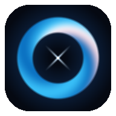

<div align="center">



# ORIXON

### **One Platform. Endless Possibilities.**

**Flagship Cross-Platform Smart TV OS Launcher • Live IPTV & M3U Studio • 4K HDR10 & Hardware-Gyroscope VR 360° / 3D Headset Media Player • Global Cloud & Wi-Fi File Share Hub • DuckDuckGo WebX Privacy Browser**

**Version:** `v1.0.0` (Build 5) • **License:** `Apache-2.0` • **Author:** **Sk Ramjan Ali**  
**Official Website & 1-Click Installer:** [https://skramjan9615.github.io/orixon/](https://skramjan9615.github.io/orixon/)

</div>

---

## Executive Overview

**ORIXON** is an all-in-one open-source multimedia operating environment and Smart TV launcher engineered in Flutter and native Android Kotlin. It unifies five flagship applications into a single, hardware-accelerated suite designed for **Android Smartphones**, **Android TV / Google TV**, **Windows 10/11**, and **macOS**:

1. **Smart TV OS Launcher & Reactive Theme Engine:** 10-foot D-Pad Leanback interface and mobile touchscreen mode with live reactive wallpapers (`Orixon Default`, `Custom Gallery Photo`, `Cosmic Nebula`, `Cyberpunk Grid`, `Aurora Borealis`, `Deep Ocean`, `Minimal OLED Pitch`), 1-minute idle Ambient Clock Screensaver, and hardware gyroscope 2-way/4-way orientation.
2. **Live IPTV & M3U Channel Studio:** High-stability stream engine with a **128 MB RAM cache**, `#KODIPROP` ClearKey DRM decryption, `#EXTVLCOPT` / `#EXTHTTP` header parsing, 9-profile User-Agent auto-rotation, and category-wise `.m3u` playlist exporter.
3. **4K HDR10+ & VR 360° / 3D Headset Media Hub:** Local video player featuring ultra-transparent glass controls, zero-lag timeline scrubbing, dedicated left/right 22% edge zones for **0–200% hardware brightness** and **0–200% audio boost**, Picture-in-Picture (PiP), and **60fps hardware gyroscope VR 360° & Side-by-Side 3D Headset** projection.
4. **Global Cloud & Wireless File Hub:** Complete file manager and multi-protocol transfer suite supporting **Global Cloud Share (Send & Receive via 6-digit code or direct link)**, **Orixon Direct Beam**, **Wi-Fi Web Portal (`:8888`)**, and **Wireless FTP Server (`:2121`)**.
5. **WebX DuckDuckGo Privacy Browser:** Native ad-blocking privacy browser centered around DuckDuckGo search with desktop mode and customizable quick-dial shortcuts.

---

## 1-Click Direct Downloads

| Target Platform | System Requirements | Package Type | Direct Download Link |
| :--- | :--- | :--- | :--- |
| **Android Phone** | Android 8.0+ (`arm64-v8a`, ~35 MB) | `.apk` Installer | [**Download Orixon.apk**](https://github.com/SkRamjan9615/orixon/releases/download/v1.0.0/Orixon.apk) |
| **Android TV / Google TV** | Android TV 8.0+ (D-Pad & Voice Remote) | `.apk` TV Edition | [**Download Orixon-Android-TV.apk**](https://github.com/SkRamjan9615/orixon/releases/download/v1.0.0/Orixon-Android-TV.apk) |
| **Windows 10 / 11** | Windows 64-bit (`x86_64`) | `.zip` Package | [**Download Orixon-Windows.zip**](https://github.com/SkRamjan9615/orixon/releases/download/v1.0.0/Orixon-Windows.zip) |
| **macOS** | Apple Silicon (`M1/M2/M3`) & Intel | `.zip` Package | [**Download Orixon-macOS.zip**](https://github.com/SkRamjan9615/orixon/releases/download/v1.0.0/Orixon-macOS.zip) |

---

## Detailed Functional Specifications

### 1. 4K HDR10 & VR 3D Media Hub (`lib/features/local_media/`)
- **Supported Containers & Codecs:** `MKV`, `MP4`, `AVI`, `MOV`, `WEBM`, `TS`, `FLV`, `M4V` with hardware-accelerated `H.264`, `HEVC (H.265)`, `VP9`, and `AV1` decoding (`hwdec=auto-safe`).
- **HDR & VR Modes:** Instant top-bar toggles for `HDR` / `HDR10` / `HDR+` tone-mapping and `VR` / `VR 360°` / `3D Headset` stereoscopic Side-by-Side dual-lens rendering driven by the phone's 60fps hardware gyroscope.
- **Precision Touch Gestures:**
  - **Left 22% Edge Vertical Swipe:** Adjusts screen brightness from `0%` to `200%`.
  - **Right 22% Edge Vertical Swipe:** Two-tier volume control (`0%–100%` hardware volume + `100%–200%` software amplification with Dolby Atmos passthrough).
  - **Horizontal Drag / Timeline Scrub:** Zero-lag instant seeking with auto-play on release.
  - **Double-Tap Left / Right:** Instant `-10s` / `+10s` skip.

### 2. Live TV & IPTV M3U Studio (`lib/features/live_tv/`)
- **M3U / M3U8 Playlist Studio:** Import playlists via URL or local file, filter and select channels by category, toggle active playlists, and export customized `.m3u` files.
- **Stream Resilience:** 128 MB RAM buffer (`cache-secs=60`), automatic 9-profile User-Agent probing, `#KODIPROP:inputstream.adaptive.license_key` ClearKey DRM support, and custom HTTP pipe header parsing.

### 3. File Hub & Global Share Suite (`lib/features/file_hub/`)
- **Storage Explorer:** Browse Internal Storage, SD Cards, and USB OTG drives with search, sort, rename, copy, move, delete, and `.zip` archive creation/extraction.
- **5-Way Send & Receive Sharing:**
  - **Global Cloud Share:** Upload any file to generate a 6-digit Receive Code or direct download link usable from any device worldwide.
  - **Orixon Direct Beam:** Device-to-device high-speed local transfer over Wi-Fi/Hotspot.
  - **Wi-Fi Web Portal (`:8888`) & Wireless FTP (`:2121`):** Send and receive files from any PC, Mac, iPhone, or Smart TV browser without installing extra software.

### 4. Universal Voice Search, Full Backup & Silent OTA Updater
- **Voice Auto-Play:** Speak a TV channel number, channel name, video title, or setting name to launch or play it immediately.
- **1-Click Full Backup & Restore:** Export all playlists, channels, media metadata, and settings into `/Download/Orixon_Backups/ORIXON_Backup_<timestamp>.json` and restore directly through File Hub.
- **In-App Silent Auto-Updater:** Check and install official updates directly inside `Settings ➔ About` with a live `0%–100%` progress modal.

---

## Technical Architecture

| Layer | Technology Stack |
| :--- | :--- |
| **UI & Cross-Platform Framework** | Flutter 3 / Dart 3 (`Material 3` + Custom Glassmorphism OS Shell) |
| **State & Local Persistence** | Riverpod (`flutter_riverpod`) + Drift SQLite (`drift` / `sqlite3_flutter_libs`) |
| **Media & IPTV Playback Core** | `media_kit` (`libmpv` hardware-accelerated video/audio pipeline) |
| **Native Android Integration** | Kotlin `MainActivity` (`SensorManager` Gyroscope, `OrientationEventListener`, `PictureInPictureParams`, `MediaStore`, `WebView`, `WifiLock`) |

---

## Building from Source

```bash
git clone https://github.com/SkRamjan9615/orixon.git
cd orixon
flutter pub get
flutter build apk --release --split-per-abi --target-platform android-arm,android-arm64 --tree-shake-icons
```

---

## License & Brand Protection

- **Open-Source Code License:** Licensed under the **Apache License, Version 2.0** (see [`LICENSE`](LICENSE) and [`NOTICE`](NOTICE)).
- **Trademark & Brand Policy:** The **ORIXON** name, official app icon, and brand assets are governed by [`BRAND_POLICY.md`](BRAND_POLICY.md).
- **Copyright © 2026 ORIXON. Created by Sk Ramjan Ali. All Rights Reserved.**
